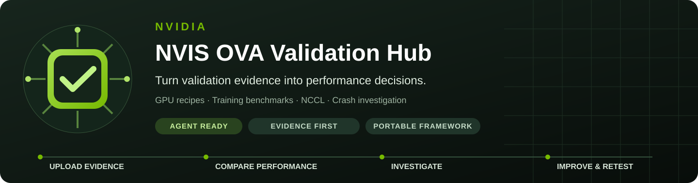
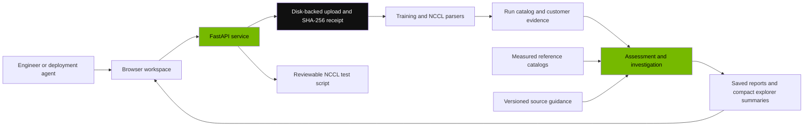

<p align="center"></p>

# NVIDIA NVIS OVA Validation Hub

**Upload validation evidence → understand the result → compare the right configuration → plan the next test.** A portable engineering workspace for GPU validation logs, NCCL and training performance, troubleshooting, reference provenance and customer engagement tracking.

The hub connects measured evidence to a practical next action. It retains original uploads, extracts results, checks available configuration against a GPU/fabric recipe, groups crash signatures and explains performance comparisons. Engineers can follow an investigation from a log bundle to a source-backed result, a controlled follow-up test and an explicitly designated final number.

**Framework distribution:** this repository contains application code, synthetic regression fixtures, deployment templates, agent instructions and documentation. Customer logs, production databases, downloaded source bodies, reference snapshots, engagement history and credentials belong in private deployment storage. A fresh instance starts without imported customer or benchmark data.

[Easy deployment](docs/easy-deploy.md) · [Agent handoff](skills.md) · [Product workflow](docs/product-workflow.md) · [Comparison policy](docs/comparison-policy.md) · [Reference integrations](docs/reference-integrations.md) · [Operations](docs/operations.md)

## 1. What the framework helps you accomplish

| Engineering question | Hub workflow | Result to review |
| --- | --- | --- |
| What actually ran, and at what scale? | Validation explorer and parsed run detail | Workload, configuration, measured values, execution evidence and original-source receipt |
| Does the available configuration match the intended GPU/fabric recipe? | Configuration checks | Observed matches, mismatches and missing evidence; site-policy unknowns remain visible |
| Why did the run stop or fail? | Crash analyzer and investigation | Grouped signatures with file/line evidence, parent-job context and applicable next diagnostics |
| Is NCCL bandwidth below a relevant recorded result? | Compact 16 GiB / 32 GiB comparison | Your GB/s, best matching recorded GB/s and percentage over/under, with reference scope |
| How does training throughput compare? | Model/configuration-aware training assessment | Throughput and step-time comparisons with explicit statistics and context gaps |
| What should we test next? | Follow-up plans and NCCL script generator | Purpose, expected outcome, source guidance and a reviewable controlled test |
| Where is each customer engagement? | Customer summary and engagement board | Validation counts, active/planned work, valid logs, linked investigations and designated final results |
| Where did the target or recommendation come from? | Reference libraries and provenance receipts | Source record/page identity, version or snapshot, hashes and applicability |

An execution status, a correctness result and a performance comparison answer different questions. The hub preserves those distinctions: a fast failed run remains failed evidence, an absent reference remains unavailable, and a conditional comparison is not acceptance.

## 2. Product workspace

### Validation explorer

Search by cluster alias, workload, collective, GPU/node scale, NCCL version, execution status and recorded topology. Filter measured evidence when diagnostic logs or scheduler artifacts would otherwise dominate the result list. Open a row to inspect the underlying measurements, source receipt and recorded configuration.

NCCL comparisons appear directly in **two compact columns**, rather than a wall of metric cards:

| Validation run | Performance | 16 GiB | 32 GiB | Evidence |
| --- | --- | --- | --- | --- |
| Synthetic collective run | 400 GB/s bus peak | **400 GB/s · 20% under** | — Unavailable | Correctness passed |

This example uses constructed values: the matching 16 GiB reference is **500 GB/s**, so `100 × (400 / 500 − 1) = −20%`. **GB/s measures bandwidth; GiB measures message size.** The peak in the Performance column is a run summary; the size columns compare the recorded measurement at that particular size.

The detail view contains two rows—best recorded, yours and over/under—plus four short improvement options. Reference scope is available in the detail note; source links and tooltips retain the supporting context. Raw curves and configuration/provenance remain expandable. Missing 32 GiB evidence is never interpolated or invented. Native element-count rounding is disclosed through the actual-byte tooltip, and reference matching uses those exact bytes.

### Upload your evidence

The primary investigation workflow supports **1 GB per file** with disk-backed receipt and retention. ZIP, tar, tar.gz/tgz and tar.zst/tzst bundles are supported, alongside supported text/compressed logs. Archive processing is bounded to **32 GiB expanded data** and **25,000 members**.

The progress bar shows transfer, with cancellation available while uploading. Saving, extraction and analysis can continue afterward. Retained originals have SHA-256 receipts, and received-evidence status exposes recovery progress if processing needs to be resumed. Keep the browser open until the investigation result is returned.

Large bundles produce explicit artifact counts with capped/paginated visible lists. Measured training and NCCL results are prioritized; diagnostic evidence remains indexed. Saved investigations can be reopened using `?analysis=<analysis-id>`.

Optional benchmark-context JSON captures information the operator knows, such as model/precision, release, sequence length, parallelism or NCCL test protocol. **User-declared context stays distinct from measured log evidence.**

### Four investigation tools

| Tool | What it does | Evidence boundary |
| --- | --- | --- |
| Configuration checks | Compares recorded environment/configuration with a versioned GPU/fabric recipe | Unknown firmware, topology or site policy cannot be inferred from a selected recipe |
| Crash analyzer | Groups recognized signatures with file/line excerpts, decodes Xid codes and lists the hosts named in the log ([details](docs/crash-evidence.md)) | A signature or Xid points to where to look; it doesn't prove root cause, and a host that logged an error isn't necessarily the faulty one |
| Follow-up tests | Explains diagnostic actions, expected outcomes, applicability and cautions | Recommendations do not automatically change infrastructure |
| NCCL script generator | Produces a downloadable Slurm launcher with correctness checks and repeated measurements | Generation does not submit a job or run a test |

Scheduler termination, numerical failures, optional diagnostic/probe failures and parent-job failure context are considered separately where the evidence supports that distinction. Individual-file NCCL correctness does not override a failed parent validation.

### Training performance

Training analysis retains throughput in TFLOP/s/GPU and step-time measurements. References are selected using the model/workload and available configuration, including model size, GPU/scale, precision, release, batch/sequence settings and parallelism dimensions.

The interface labels a run's **mean** summary separately from the **median** used by the benchmark assessment. Higher throughput and lower step time have opposite improvement directions; comparisons account for that. Missing or differing context remains conditional/unknown rather than silently qualifying a result. Unrelated models are not pooled into one best-performance number.

### Customer and engagement board

Map a customer alias to its clusters and track planned, active, blocked and completed engagements. The summary brings together validations, valid logs, saved investigations, best eligible configurations and final/Exemplar designations. Evidence can be associated with a customer without requiring an engagement for every standalone result.

Final-number and Exemplar labels are **explicit local designations** on eligible measured evidence. Failed, parent-failed, nonfinite or incomplete results cannot establish qualified final evidence. These labels neither certify an entire cluster nor publish results to an external Exemplar service.

### NCCL test scripts

Versioned recipes cover **H100, H200, B200, B300, GB200 and GB300** with **InfiniBand or Spectrum-X**. Supply the target site's approved partition, container, MPI nccl-tests path, GPU-facing HCA ports and bootstrap interface. Review allocation, topology and runtime compatibility before submission.

Generated launchers assume **Slurm + Pyxis/Enroot + PMIx**. Defaults are fixed **2 GiB**, **50 warm-up iterations**, **100 measured iterations** and **three repeats**, with optional rail/split isolation. Registration is optional and depends on the installed test build. Experimental presets are limited to Spectrum-X all-to-all, record their overrides and support changing one setting at a time.

The generator currently permits message sizes up to **16 GiB**. Imported **32 GiB** evidence can be compared even though that size is not currently generated by this UI. Recipes do not guess or modify switch QoS, PFC, ECN, traffic class, congestion control, firmware or routing. GB-system NVLink/IMEX domain requirements and allocation boundaries require site-specific review.

## 3. Reference integrations: measured data and guidance

Source access and coverage are configured independently for each deployment. A document mention, source metadata count or existing login on another host does not establish local measured-reference coverage.

| Integration | Implemented capability | What is not implied |
| --- | --- | --- |
| **BEACON training** | Authenticated API sync, authorized export import, filters, snapshot receipts and compact downloads | No source access without valid authorization; reference results are separate from customer uploads |
| **Measured NCCL sources** | Supported benchmark-service/dashboard indexers, import, GPU/fabric/scale/collective filters, compact previews and reassessment | An adapter is required for unsupported schemas; count-only metadata is not measured coverage |
| **Confluence** | Authorized read-only discovery/download, searchable versioned pages, hash receipts, reviewed guidance and supported measured-table extraction | A wiki page is not automatically a numeric baseline; charts/tables need an actual applicable extraction |
| **Exemplar** | Training-log analysis, workflow/recipe source references and local final/Exemplar evidence designations | No general authenticated-site crawler, automatic result submission or external certification |
| **NVBugsPro** | Manual external investigation reference/handoff | No authenticated bug-query API connector, issue synchronization, automatic bug matching or issue creation |

Reference receipts preserve source URLs, source record/job identifiers, configuration and snapshot/hash information. Confluence findings retain page/version and section/table context. The source library distinguishes global active inventory from a single import's scope. Missing GPU/fabric coverage remains visible.

Reference refresh and reassessment expose queued, running, complete, partial and failed states. A successful source import does not hide failed per-analysis reassessment. See [reference integrations](docs/reference-integrations.md) for formats, authentication and provenance details.

## 4. Matching and acceptance

**NCCL's compact view uses the best independent recorded bus bandwidth at the same exact message size and matching NCCL version/configuration.** It does not mix algorithm bandwidth or latency into those two cells. A contextual historical cluster reference is disclosed as such when full fabric metadata is unavailable.

Qualified exact NCCL baselines retain stricter completeness, correctness and configuration requirements: nodes/GPUs, hardware, transport, collective, NCCL version, message bytes, datatype, operation, placement and comparable split/protocol/topology evidence. A number can be useful for diagnosis without proving full recipe qualification.

Training assessment exposes both arithmetic performance bands and match quality. The default application policy is good within 5% below reference, bad up to 10% below and worst for a larger deficit. Those application bands do not replace a source document's applicability requirements or a site's acceptance criteria. Conditional ratios remain unscored.

See [comparison policy](docs/comparison-policy.md) for the complete handling of missing context, exact bytes, statistics, failed jobs and final-result eligibility.

## 5. Architecture and persistence



| Component | Role |
| --- | --- |
| `frontend/` | Static browser UI for explorer, upload, investigation, sources and engagements |
| `backend/` | FastAPI routes, bounded evidence handling, parsers, matching, source adapters and recipes |
| SQLite catalogs | Parsed runs, ownership, saved investigations, cached assessments and separate reference/guidance stores |
| Deployment data root | Retained originals, derived evidence, source snapshots, catalogs and local operational artifacts |
| `tools/` | Operator-facing indexing, extraction, reassessment, recovery and publication checks |
| `tests/` | Synthetic/isolated regression fixtures; no deployed customer dataset |
| `deploy/` | Compose/service templates and deployment guidance |
| Agent instructions | Repository rules, workflow entry points and checkpoint/handoff conventions |

The evidence lake is a local catalog plus retained files and source receipts. It does not require a hosted analytics service. Keep the data root separate from the checkout and back it up consistently with the catalogs. [Architecture](docs/architecture.md) documents the module boundaries; [operations](docs/operations.md) covers recovery and storage.

## 6. Deploy a fresh instance

Start with [easy deployment](docs/easy-deploy.md) and the full [deployment guide](docs/deployment.md). Configure the new geography's storage, access boundary, source authorization and cluster/site policy; do not copy another deployment's customer databases or credentials.

### Container route

From the repository root, on a Docker/Compose-capable host:

```bash
cp .env.example .env
# Review/edit non-secret settings and private credential-file references.
docker compose -f deploy/compose.yaml config
docker compose -f deploy/compose.yaml up --build -d
curl --fail http://127.0.0.1:8081/api/health
```

The supplied Compose service binds to **localhost**, uses UID/GID **10001**, a persistent named volume, a read-only root filesystem and bounded temporary storage. Mount credentials separately; private mode-0600 files must be readable by the service identity. BEACON cookie rotation can require write access to the cookie directory.

### Local Python route

The packaged dependency lock targets **Python 3.14**:

```bash
python3 -m venv .venv
. .venv/bin/activate
python -m pip install -r requirements.lock
export VALIDATION_DATA_ROOT="$PWD/var/validation-hub"
uvicorn backend.app:app --host 127.0.0.1 --port 8081 --workers 1
```

`VALIDATION_DATA_ROOT` defaults to repository-local `var/validation-hub`; individual catalog/upload paths can be overridden. Container deployments use `/var/lib/validation-hub`. See `.env.example` and the deployment guide for the full settings.

The application has **no built-in login, RBAC or per-customer security isolation**. Shared deployment requires an authenticated TLS reverse proxy. Customer ownership is workflow metadata. Operate with **one Uvicorn worker**: synchronization/reassessment jobs are process-managed and are not a distributed durable queue. Restarted jobs require inspection and retry.

## 7. Give the repository to an agent

The repository's agent documents are explicit instructions for an agent working in an authorized environment; they are not an automatically installed plugin or a claim of autonomous remote cluster access.

| Entry point | Purpose |
| --- | --- |
| [AGENTS.md](AGENTS.md) | Repository routing, evidence boundaries and contribution rules |
| [skills.md](skills.md) | Human-readable agent workflow and handoff index |
| [SKILL.md](SKILL.md) · [Deployment skill](skills/validation-hub-deploy/SKILL.md) | Skill entry point and task contract |
| [Agent harness](agent-harness/README.md) · [Prompt](agent-harness/PROMPT.md) · [Provider guide](agent-harness/PROVIDERS.md) | Execution/checkpoint/handoff workflow and provider-specific setup |
| [Easy deployment](docs/easy-deploy.md) | Fresh-instance preparation and verification |

Example task for an agent:

```text
Read README.md, AGENTS.md, skills.md, SKILL.md and agent-harness/README.md.
Prepare a fresh Validation Hub deployment in the approved target environment.
Use docs/easy-deploy.md and docs/deployment.md. Keep deployment data and
credential files outside Git. Discover existing services and active work first.

Target environment: <APPROVED_HOST_OR_LOCAL_WORKSPACE>
Persistent data root: <PRIVATE_DEPLOYMENT_PATH>
Access boundary: <LOCAL_ONLY_OR_APPROVED_AUTHENTICATED_TLS_PROXY>
Authorized sources: <SOURCE_NAMES_OR_NONE>
Scope: <PREPARE_AND_VERIFY_HUB>; do not submit GPU jobs unless separately authorized.

Verify an empty start, health, a synthetic upload, saved report reopening,
reference-unavailable behavior and generated-script review. Record checks,
remaining unknowns and a resumable handoff. Do not print or commit secrets,
copy production datasets, or claim unperformed cluster validation.
```

Source credentials must be provisioned through approved private files, not pasted into chat or committed configuration. Running a hub acceptance check and validating a GPU cluster are separate activities.

## 8. Validation, CI and release boundaries

Run tests against isolated temporary data:

```bash
python tools/check_publication.py
python tools/check_docs.py
python -m compileall -q backend tools agent-harness tests
python -m pytest -q
node --check frontend/app.js
node --check frontend/workflows.js
```

GitLab CI runs Python/application/harness tests, publication and documentation checks, and JavaScript syntax checks on the Factory Linux Docker runner tags. A source-package job produces the committed software archive with a per-file manifest and SHA-256 checksum. Container image building is opt-in for an approved release tag with `BUILD_CONTAINER=1` and a suitably configured Docker-capable runner. CI does not deploy another geography or submit hardware jobs.

The current local framework suite reports **260 passing tests**, including provider-neutral deployment orchestration and source-release integrity tests; see the [validation record](docs/validation.md) for evidence and limits. Browser checks and synthetic regressions validate application behavior; they do not establish a real cluster's performance. Container build/start and target-environment commissioning remain separate checks where not yet performed.

[Published source history](docs/source-history.md) identifies the earliest retained framework snapshot and enhancement branch. That snapshot is not an invented pre-session origin. The [future MR draft](docs/merge-request-draft.md) and [Slack announcement draft](docs/slack-announcement.md) are review artifacts, not evidence that a merge request or announcement has been posted.

## Documentation map

| Guide | Read it for |
| --- | --- |
| [Product workflow](docs/product-workflow.md) | Upload, investigation, engagement and test-generation behavior |
| [Crash evidence](docs/crash-evidence.md) | Xid decoding, host lists and the repeat-host roll-up |
| [Comparison policy](docs/comparison-policy.md) | Exact versus contextual matching, statistics and qualification |
| [Reference integrations](docs/reference-integrations.md) | Implemented adapters, private authentication and source receipts |
| [Architecture](docs/architecture.md) | Data flow, persistence and module responsibilities |
| [Easy deployment](docs/easy-deploy.md) | First startup and acceptance workflow |
| [Deployment](docs/deployment.md) | Runtime configuration, containers, host service and site inputs |
| [Operations](docs/operations.md) | Storage, backup, recovery, job lifecycle and known limits |
| [Release enhancements](docs/release-enhancements.md) | Framework feature inventory |
| [Validation](docs/validation.md) | Recorded checks and remaining validation |
| [Source history](docs/source-history.md) | Publication baseline and branch provenance |
| [Factory contract](docs/factory.md) | Clean source delivery, CI, archive integrity and publication boundaries |
| [Contributing](CONTRIBUTING.md) | Repository changes and required verification |

## Known limits to plan around

- Main investigations accept **1,000,000,000 bytes**, while the separate single-log comparison path has a **32 MiB** limit. Reference imports have a separate **50 MiB** compressed-file limit.
- Archive limits and UI caps bound processing/display; they do not provision storage. Retained originals, expanded evidence, snapshots, SQLite WAL files and backups all consume capacity.
- Source authentication expires. Unsupported source schemas need adapters. Indexed guidance and imported measurements must remain distinguishable.
- Generated scripts target the documented Slurm/container route. Other schedulers/runtimes need reviewed adapters. Site fabric/QoS policy is never inferred from a generic GPU recipe.
- Background jobs are not distributed or automatically resumed after service restart. Automated retention, cross-region replication and customer-level authorization are not implemented.
- A crash signature, reference ratio, final designation or successful hub deployment alone does not certify cluster health or acceptance.
