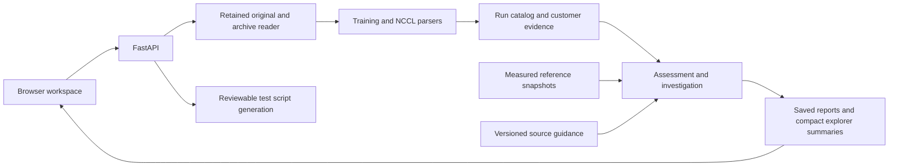

# Architecture

The framework serves a static browser application and a FastAPI backend. It uses local SQLite stores and disk-backed evidence rather than a hosted analytics dependency.

## Modules

| Area | Main modules | Responsibility |
|---|---|---|
| Web/API | `frontend/`, `backend/app.py` | Explorer, uploads, run detail and static assets |
| Upload and lake | `backend/upload_io.py`, `backend/lake.py` | Streaming receipt, SHA-256, bounded archive handling and evidence inventory |
| Parsing and comparison | `backend/parser.py`, `backend/compare.py` | Measured results, execution evidence and exact baseline comparison |
| Performance | `backend/assessment.py`, `backend/performance.py`, `backend/nccl_reference.py`, `backend/nccl_summary.py` | Training and NCCL matching, assessments and compact 16/32 GiB summaries |
| Investigation | `backend/investigation.py`, troubleshooting modules, `backend/crash_enrichment.py` | Configuration/crash findings, Xid decoding, host lists, source-backed next tests |
| Recipes | `backend/recipes.py` | Versioned GPU/fabric profiles and downloadable test launchers |
| Customers | `backend/engagements.py` | Ownership, engagement state, evidence links and result designations |
| Sources | `backend/beacon.py`, `backend/beacon_nccl.py`, `backend/wiki_sources.py` | Separate reference catalogs, snapshots and indexed guidance |
| Source extraction | `backend/confluence_client.py`, `backend/confluence_reference.py`, `backend/nccl_dashboard.py`, `tools/index_*` | Authorized source reads, extraction and receipt-preserving imports |

## Persistence boundaries

The primary catalog stores parsed run payloads, source receipts, customers, engagements, investigations and cached assessments. Separate SQLite files store training references, NCCL references and indexed Confluence evidence. Original uploads and reference/source snapshots remain files on the deployment data volume.

A raw observation, an imported historical scheduler verdict, a source reference and a customer's final-result designation have different meanings. The application retains their provenance rather than treating each as equivalent proof of validation.

Reference synchronization and reassessment use background jobs with progress. Job state is stored, but a process restart marks unfinished work failed; an operator must retry. This is a single-service deployment design rather than a distributed durable worker queue.
